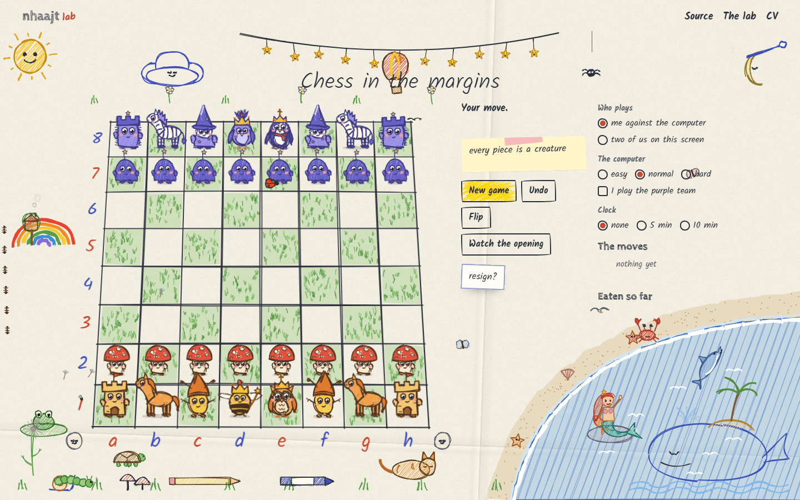
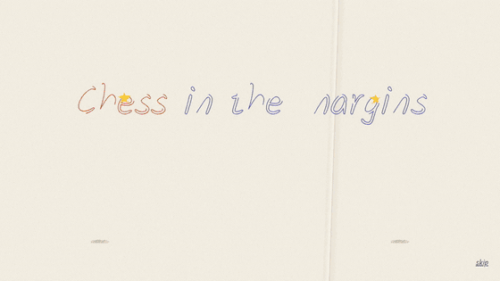
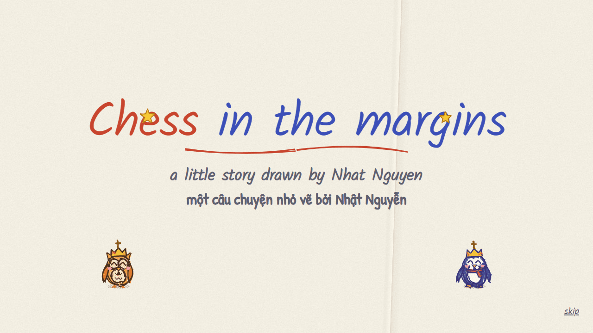
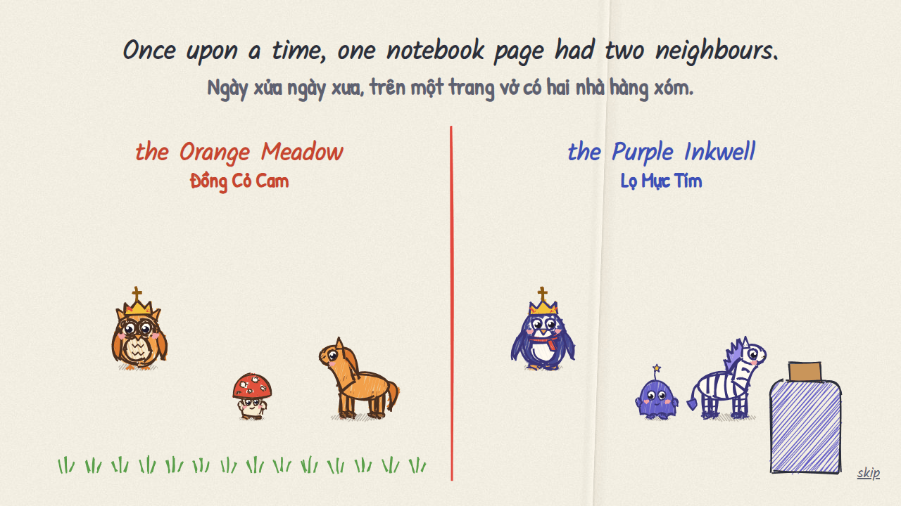
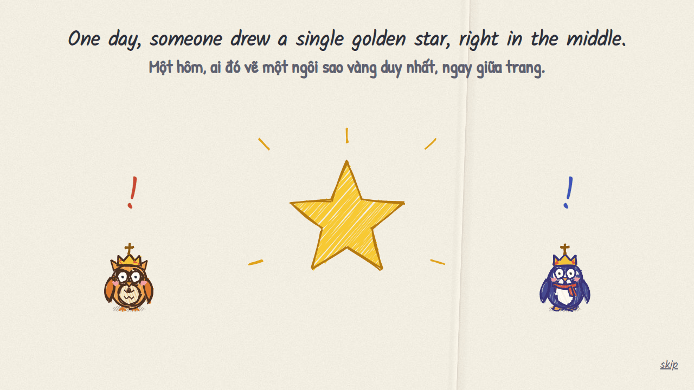
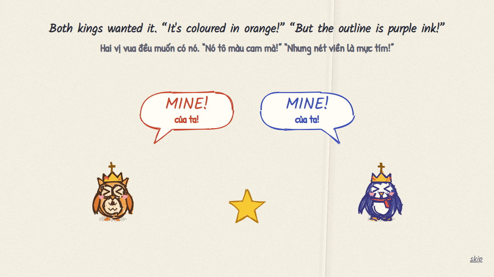
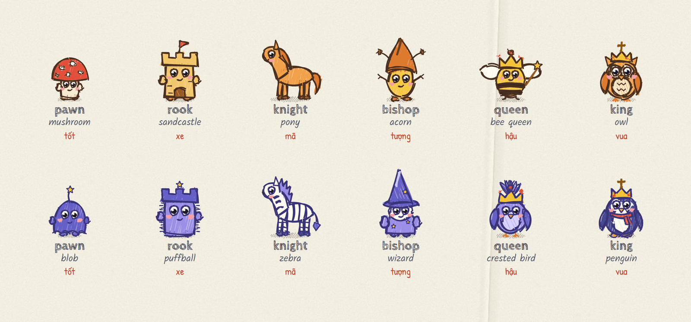
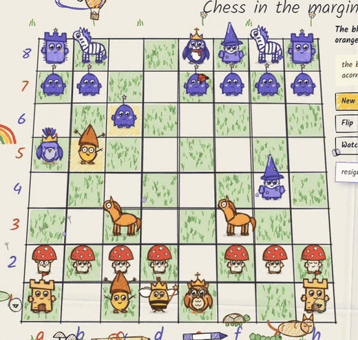
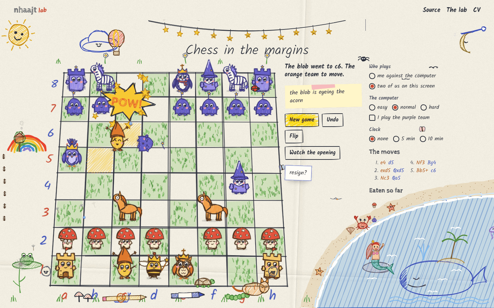
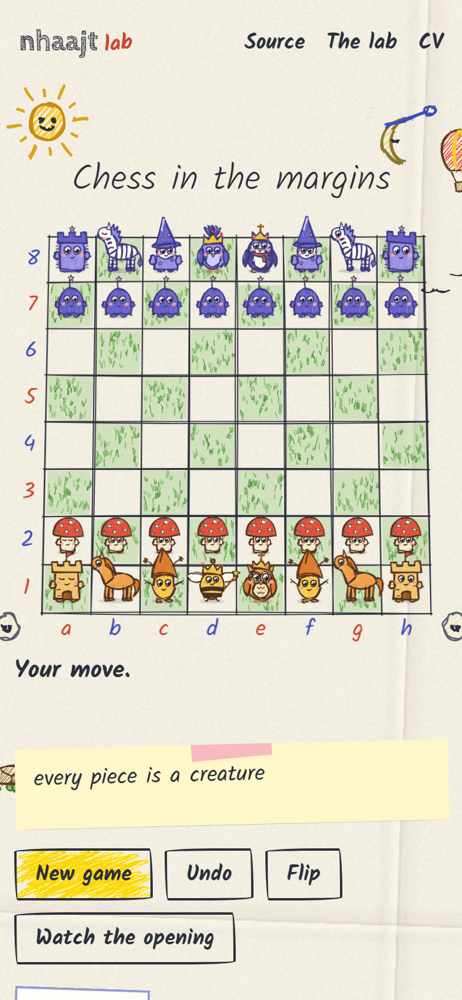

<div align="center">

# Chess in the margins

**Chess drawn in ballpoint on a sheet of paper, where every piece is a creature and captures get personal.**

[**Play it now: lab.nhaajt.com/chess**](https://lab.nhaajt.com/chess) · [Tiếng Việt](#tiếng-việt) · [How it works](#how-it-works)




</div>

## The story so far

Once upon a time, one notebook page had two neighbours: **the Orange Meadow** and **the Purple Inkwell**.
One day someone drew a single golden star right in the middle of the page. The owl king said it was coloured
in orange crayon, so it was theirs. The penguin king said the outline was purple ink. So they settled it the old way:
sixty-four squares, one move at a time.

The game opens with that story, drawn scene by scene in English and Vietnamese. Each scene is rubbed out by an
eraser before the next one is drawn, and then the board itself is drawn line by line.

<div align="center">

</div>

<table>
<tr>
<td></td>
<td></td>
</tr>
<tr>
<td></td>
<td></td>
</tr>
</table>

## Every piece is a creature

Each creature is drawn in code, not taken from a picture, so it has real joints: legs that walk, arms that wave,
a hat that can fly off, and a face that changes. Each still wears its chess sign: a cross on the king's crown, a jewel
on the queen's, a slit mitre for the bishops, battlements for the rooks and a horse for the knights.

<div align="center">

</div>

While they wait, they breathe, blink, look around and fidget in their own way. The bee's wings never stop,
the pony paws the ground, the blob floats. Pick one up and it grins and waves while its friends turn to look.
When something can take it, it trembles, covers its face and sweats. A king in check clutches its head.

## Captures get personal

Every capture is a small fight, and each kind of creature fights its own way. The mushroom headbutts, the pony rears
and kicks with its back legs, the acorn throws an acorn and the wizard casts a zigzag bolt. The castle stamps a shockwave
into the board, the puffball rolls into its target, the bee queen flicks her wand and the owl slaps with a wing.
The loser's eyes go `><`, then dizzy spirals, its hat spins away, it falls flat on its back, and it floats off to the tray.

<div align="center">

</div>

## A page that is alive

Nothing on the page stands still. The pen lines boil like hand-drawn animation, and the margins are full of small
lives. A sun spins its rays and laughs when someone is taken. A moon in a nightcap snores. A whale gets coloured in as
the game goes on and spouts at every capture. In the corner a mermaid waves from her rock, dolphins leap, a crab
scuttles along the sand, and a frog catches flies from a lily pad. A rain cloud waters a flower that grows a little
with every drop. There is also a spider on a thread, a hot-air balloon, a paper aeroplane looping the loop, a snail
that takes the whole game to cross the page, and a cat asleep at the bottom.

<table>
<tr>
<td width="62%"></td>
<td></td>
</tr>
</table>

## What you can do

- Play the computer on easy, normal or hard, as either team, or play a friend on the same screen.
- Use a 5 or 10 minute clock. Every second the old time is crossed out and the new one written in.
- Undo, flip the board (it turns round on the table) or resign with a sticky note that asks `resign?`.
- Read the commentary on a sticky note, which notices forks, checks, hanging pieces and castling.
- Play with the keyboard: Tab to the board, arrow keys to move around, Enter to pick up and put down.
- With reduced motion turned on in your system, everything holds still and the whole game still works.
- On a computer the whole game fits on one screen.

## How it works

No framework and no build step: just HTML, CSS and plain JavaScript in a handful of files.

| File | What it does |
|---|---|
| `engine.js` | The rules of chess and the computer opponent, written from scratch. It uses a 0x88 board with legal move generation, castling, en passant, promotion, 50-move and threefold repetition rules, and SAN notation. The opponent searches with alpha-beta, quiescence and MVV-LVA move ordering under a time budget. |
| `creatures.js` | The twelve creatures, drawn with [rough.js](https://roughjs.com) from separate parts (legs, arms, hat, face). Each part is drawn twice and the copies take turns so the lines boil. It also handles expressions, idle life, walking and the drawing-in effect. |
| `game.js` | Everything else: the board on a tilted plane with creatures projected onto it, moves and fights animated with [GSAP](https://gsap.com), the camera, the story, the doodles, the commentary and the clock. |
| `paper.js` | Paints the sheet of paper once on a canvas. |
| `scripts/perft.mjs` | Checks the move generator against the standard perft counts. |

The move generator matches the published perft numbers:

```
start position  depth 4   197 281
Kiwipete        depth 3    97 862
position 3      depth 4    43 238
position 4      depth 3     9 467
```

## Run it locally

```bash
git clone https://github.com/nhaajtt/chess-in-the-margins.git
cd chess-in-the-margins
python -m http.server 8000      # or any static server
# open http://localhost:8000

node scripts/perft.mjs          # check the rules
```

---

## Tiếng Việt

**Cờ vua vẽ bằng bút bi trên trang vở, mỗi quân cờ là một sinh vật, và mỗi lần ăn quân là một trận ẩu đả.**

[Chơi ngay tại lab.nhaajt.com/chess](https://lab.nhaajt.com/chess)

**Câu chuyện:** Ngày xửa ngày xưa, trên một trang vở có hai nhà hàng xóm: **Đồng Cỏ Cam** và **Lọ Mực Tím**.
Một hôm, ai đó vẽ một ngôi sao vàng duy nhất ngay giữa trang. Vua Cú bảo ngôi sao tô bằng sáp cam nên là của mình.
Vua Chim Cánh Cụt bảo nét viền là mực tím. Thế là hai bên phân xử theo cách xưa: sáu mươi tư ô cờ, mỗi lượt một nước.

- **Mỗi quân là một sinh vật vẽ bằng code**, có khớp tay chân thật. Chúng biết thở, chớp mắt, nhìn quanh, đi bộ và vẫy tay.
  Quân bị đe doạ thì run và đổ mồ hôi; vua bị chiếu thì ôm đầu. Dấu hiệu quân cờ luôn nằm trên đầu: vua có thánh giá,
  hậu có viên ngọc, tượng đội mũ có khe, xe có răng cưa, mã là con ngựa.
- **Ăn quân là đánh nhau**, mỗi loài một đòn riêng: nấm húc đầu, ngựa đá hậu, phù thuỷ phóng tia sét, lâu đài dậm đất,
  ong vẩy đũa phép, cú tát cánh. Bên thua mắt xoắn ốc, mũ bay mất, ngã ngửa rồi hoá ma bay vào khay.
- **Cả trang giấy đều sống:** mặt trời, mặt trăng ngủ, cá voi được tô màu dần theo ván cờ, bãi biển có nàng tiên cá,
  cá heo, cua, cùng ếch bắt ruồi, mây mưa tưới hoa, khinh khí cầu, máy bay giấy và mèo ngủ.
- **Phần mở đầu** là một câu chuyện ngắn song ngữ Anh–Việt, vẽ từng cảnh rồi dùng cục tẩy xoá đi trước khi vẽ cảnh mới.
- Chơi với máy (dễ, vừa, khó) hoặc hai người chung một máy; có đồng hồ, undo, lật bàn cờ, xin thua, và chơi được bằng bàn phím.
- Không framework, không build: HTML, CSS và JavaScript thuần. Engine cờ tự viết, kiểm tra bằng perft.

## Licence

MIT © Nhat Nguyen ([nhaajt](https://lab.nhaajt.com)). Made with [rough.js](https://roughjs.com) and [GSAP](https://gsap.com).
